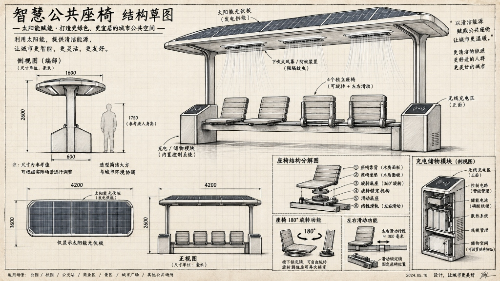

# FLEXSPACE // 智慧公共座椅 3D 数字交互展厅

<div align="center">


**面向大学校园、城市绿地、交通枢纽与商业街区的高端模块化智慧休息设施**  
*灵活座距调节 · 180°换向翻转 · 太阳能光伏双坡屋顶 · 外抛式防蚊空气风幕 · 前后双面无线快充*

### 🌐 [点击在线体验 3D 数字展厅 (Live Demo)](https://fan-fan-f.github.io/flexspace-smart-bench/)

</div>

---

## 📖 产品设计背景与核心理念 (Product Concept)

传统公共长椅虽然能容纳多人，但陌生人之间往往不愿意紧挨着坐，极易造成**“物理座位尚存，但心理安全座位已满”**的空间浪费与尴尬。

**「FlexSpace 智慧公共座椅」** 旨在通过创新的机械自锁机构与智能微气候系统，重构人与人、人与公共环境的交互关系：
- **主动调距（拓展舒适社交距离）**：座垫可在直线滑轨上横向平移，允许陌生人主动拉开距离（中间座距可从 700mm 拓宽至 1240mm）。
- **自由换向（180° 旋转避让）**：每个独立座椅可整体水平翻转 180°，实现面对面交流或背对背视线避让（如 `↑ ↓ ↑ ↓` 模式），且始终为单一完整座面与靠背，无多余冗杂结构。
- **微气候防蚊（25° 外抛空气幕）**：顶棚根据温湿度自适应向下并向外吹出 25° 扇形气幕，将蚊虫物理推拒在外围，免受叮咬。
- **绿色能源闭环**：双坡微倾光伏屋顶全天候发电，供给下置磷酸铁锂储能电池，为前后 4 处手机无线快充台与风幕全天候供电。

---

## 📐 工程草图与尺寸规格 (Engineering Blueprint)

整体尺寸 строго 对齐官方工程草图设计规范：
- **总长宽度**：`4200 mm` (4.2m)
- **立面总高**：`2600 mm` (脊高约 2.68m)
- **顶棚进深**：`1600 mm` (挑檐深度)
- **基座进深**：`600 mm` (下沉式低重心箱体)

<div align="center">
  
</div>

---

## ⚙️ 核心机械装配层级架构 (Mechanical Hierarchy)

产品在 Three.js 场景图中严格按照工业装配关系树拆分构建，杜绝单一网格建模：

```
FlexSpaceBench (Root)
├── CanopySystem (顶棚系统)
│   ├── GableSolarRoof (双坡微倾 7° 单晶硅光伏阵列 + 中脊铝合金封梁)
│   ├── CanopyUpperShell (双坡流线型上壳体)
│   ├── AirCurtainModule (4 组嵌入式贯流风机与扇形出风道)
│   └── CanopyLowerCeiling (下饰板 + 4000K 线性防眩护眼 LED 灯带)
├── SupportPillars (左右高强度流线铝合金承重主立柱)
├── MainBeamSystem (承重中轴主梁)
│   ├── StructuralBoxBeam (4.2m 重型箱型承重横梁)
│   └── LinearDualRails (双列精密钢导轨 + 80mm 阵列物理定位孔)
├── ModularSeats (4 套完全独立的模块化座椅 · 旋转在上，滑动在下)
│   ├── SeatShell (座椅本体：4 横板耐候木质座垫 + 4 横板靠背)
│   ├── RotationPlate (圆形回转底盘：水平 360°/180° 自锁换向)
│   ├── RotatingRailLock (后置快拆偏心凸轮锁扣手柄 + 淬火合金定位销 · 随椅身同步转向)
│   ├── LockingHub (旋转基准自锁齿圈环)
│   └── SliderCarriage (滑动小车：双轴滚珠导轨滑块)
└── BaseModules (左右功能储能基座 · 前后镜像对称)
    ├── ChamferHousing (倒角金属外壳 + 侧边散热百叶窗)
    ├── QiChargingFront (前倾斜 15W Qi 无线磁吸快充台)
    ├── QiChargingRear (后倾斜 15W Qi 镜像无线快充台 · 全设施共 4 席)
    └── InternalCutaway (下置 LiFePO4 磷酸铁锂电池组 + MPPT 控制器 + 散热片)
```

---

## 🚀 3D 数字展厅功能特性 (Interactive Features)

### 1. 360° 全自由度检视与多预设视角
- **OrbitControls**：支持平滑阻尼惯性旋转、滚轮缩放、右键平移。
- **6 种专业视角一键飞越**：全景透视、正立面 (4.2m)、侧视微倾屋顶 (1.6m)、顶视光伏双坡、锁扣/旋转/滑轨特写、双面充电/电池仓。

### 2. 科学分层爆炸图 (Exploded View)
- 0% ~ 100% 无级平滑调节滑块与一键拆解展开。
- 遵循真实装配逻辑：光伏双坡升起 $(+1.25\text{m})$、出风道下落 $(-0.45\text{m})$、座体向上脱离 $(+0.55\text{m})$、基座外壳向两侧滑动展开 $(\pm 0.85\text{m})$，清晰透视内部电芯与导轨。

### 3. 四大功能动态演示 (Live Feature Demos)
- ↔️ **开锁滑动间距演示**：演示扳开锁扣手柄、拔出定位销、滑轨向外滑移拓宽社交距离、到位后手柄自动下压重新锁止的全流程。
- 🔄 **180° 换向翻转 (↑↓↑↓)**：座椅 2 和 4 旋转 180° 掉头，锁扣随椅身同步转向至乘员椅背正下方，避免磕碰小腿。
- ⚡ **前后双面无线充与能量流**：激活前后 4 处 Qi 快充台，呈现太阳能流光脉冲注入电池并供电手机的能量路径。
- 💨 **外抛式防蚊空气幕 (25° 扩散)**：顶棚 4 个喷口向下吹出 650+ 颗微蓝层流粒子，并呈 25° 夹角向外扩散抛散，形成推拒蚊虫的空气幕穹顶。

### 4. 📐 3D CAD 工程尺寸标注
- 一键在 3D 空间投射 `4200 mm` 总宽、`2600 mm` 总高、`1600 mm` 顶棚进深虚线引线。
- **动态座距计算**：座椅滑动时，实时刷新中间两席的物理间距数值（700mm $\rightarrow$ 1240mm）。

### 5. 🎯 单椅光线投射独立控制 (Raycasting Inspector)
- 鼠标直接在 3D 场景中点击任意一把椅子，即可单独对其进行**180° 翻转**、**向左/向右滑移 15cm**，或单独**扳开/压紧机械锁扣**。

### 6. 🎨 CMF 材质与配色工艺定制
- **木质面板**：北欧金柚木（标配）、北美黑胡桃木、炭灰耐候复合木、浅白橡木。
- **金属构架**：阳极氧化银（标配）、深空钛空灰、曜石磨砂黑、香槟哑光金。

### 7. 🌙 昼夜环境与顶棚线性 LED 防眩照明
- 一键切换夜景模式：阳光减弱为静谧月光，顶棚下方 4000K 线性防眩 LED 光带与地面夜景光晕柔和点亮。

### 8. 🌤️ 微气候 AI 防蚊自动决策仿真
- 调节环境温度（15°C~38°C）与湿度（30%~95%）滑块，直观展现达到蚊虫高发阈值时系统自动启旋风幕的算法决策。

---

## 💻 本地运行指南 (Local Development)

本项目为纯静态单文件架构，无外部构建依赖，即开即用：

```bash
# 克隆仓库
git clone https://github.com/Fan-Fan-F/flexspace-smart-bench.git
cd flexspace-smart-bench

# 使用 Python 启动本地 Web 服务器
python -m http.server 8080
```

在浏览器中打开：`http://localhost:8080` 即可畅享 3D 展厅！

---

## 🛠️ 技术栈 (Tech Stack)

- **3D 渲染**：[Three.js](https://threejs.org/) (r128)
- **控制器**：Three.js OrbitControls
- **补间动画**：[GSAP](https://greensock.com/gsap/) (v3.12)
- **PBR 纹理**：HTML5 Canvas 程序化动态生成（零外部图片资源依赖，免除 CORS 跨域问题）
- **UI 框架**：现代 CSS3 毛玻璃 (Glassmorphism) + 响应式布局

---

## 📄 开源许可 (License)

本项目采用 [MIT License](LICENSE) 开源协议。
